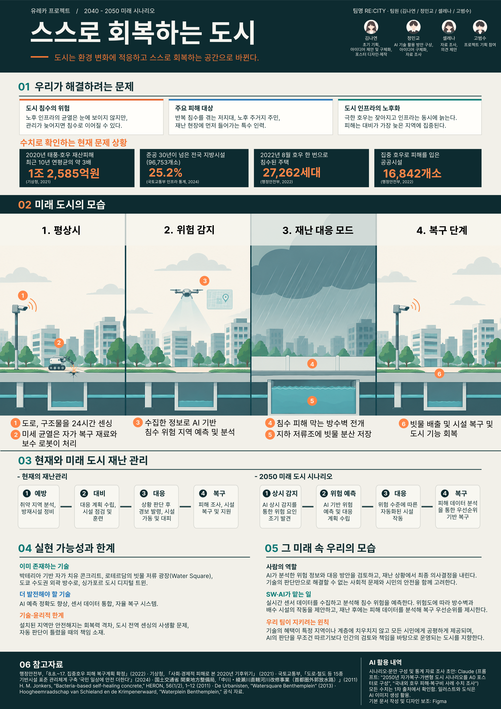

# Welcome to E26-SW01-05 - 코드웨이브

## 🎯 팀 슬로건

> "error는 있어도 포기는 없다."

## 🖼️ 팀 포스터

<div class="poster"></div>

<p align="center" class="poster-caption"><sub>포스터 제작 및 아이디어 제시: 김나연 / 아이디어 확장 및 발표: 정민교 / 아이디어 확장: 셀레나</sub></p>

[E26-SW01-05.pdf](https://github.com/user-attachments/files/34560367/E26-SW01-05.pdf)


1965년에 35년 뒤의 생활을 상상해 그린 이 그림처럼, 우리 팀이 그리는 미래를 포스터로 만들어 봅시다.
팀 활동으로 만든 포스터를 `poster.jpg` 파일 이름으로 이 repository에 업로드하면 위 그림이 팀 포스터로 바뀝니다.
파일 이름이 다르거나 png 파일이면 위 파일 이름을 맞추고, 출처 문구도 팀에 맞게 고쳐 주세요.

> **포스터 파일 권장 규격**: A4 세로 비율(1 : 1.414), 1240×1754px 이상, JPG, 2MB 이하.
> 홈페이지에서는 어떤 크기·비율의 파일을 올려도 같은 크기의 세로 틀 안에 맞춰 표시되지만, 권장 규격을 지키면 여백 없이 가장 선명하게 보입니다.


***

## 1️⃣ 팀원 소개

| **이름** | **전공** | **관심사** | **취미** |
| --- | --- | --- | --- |
| **고범수** | 소프트웨어학부 | 인공지능, 미디어 매체 | 스포츠시청 |
| **김나연** | 소프트웨어학부 | 웹 개발, 프로그래밍 | 자수 뜨개질 |
| **정민교** | 소프트웨어학부 | ai개발, 추천시스템 | 요리 |
| **셀레나** | 소프트웨어학부 | 코딩, 새로운 것 배우기 | 영화나 드라마 등 미디어 감상 |


### 팀 소개

실패를 두려워하지 않고, 오류가 생기면 함께 해결하며 끝까지 도전하는 팀입니다.
에러는 우리의 과정일 뿐, 포기하지 않는 것이 우리의 원칙입니다!

***

## 2️⃣ 공통된 관심사 : 여행, 백엔드, 인공지능

***

## 3️⃣ 한학기 동안의 활동 내역

####  <과거의 사람들이 꿈꾼 세상> 

## 📌 주제: 이정문 화백의 1965년 미래 상상도

---

## Team Mission 1: 과거 사례 4분류 및 근거

| 분류 | 사례 | 분류 근거 |
|---|---|---|
|  현재 가능 | 태양광 주택 | 태양광 패널 기술은 일반 주택에서도 보편적으로 설치·상용화됨 |
|  현재 가능 | 전기차 | 배터리 기술 발전과 충전 인프라 확대로 이미 대중 시장에서 널리 판매됨 |
|  현재 가능 | 인강(온라인 수업) | 인터넷·영상 플랫폼 보급으로 원격 학습이 일상적인 교육 방식으로 정착함 |
|  현재 가능 | 무빙워크 | 공항·쇼핑몰 등에서 이미 표준 설비로 자리 잡아 특별한 기술이 아니게 됨 |
|  일부 가능 | 청소 로봇(로봇청소기) | 자동 청소는 가능하지만 사람 수준의 완전 자율 가사도우미는 아니고 보조 도구 수준에 머묾 |
|  일부 가능 | 비대면 진료 | 기술적으로는 구현됐지만 법·제도적 규제로 아직 완전히 대중화되지 못함 |
|  일부 가능 | 자동 음식 배급기 | 밀키트·배달앱·조리로봇 등으로 기능이 분산 구현됐지만, 상상했던 하나의 통합 기계로는 실현되지 않음 |
|  아직 어려움 | 달나라 여행 | 기술적으로는 가능하나 비용·안전성 문제로 일반 대중에게 열려있지 않음 |
|  방향 전환 | 소형 TV 전화기 → 스마트폰 | 상상한 전용기기 형태 대신 통신·영상·컴퓨팅이 통합된 전혀 다른 형태의 기기로 실현됨 |
|  방향 전환 | 전파 신문 → 인터넷 뉴스 | 무선으로 인쇄물을 받는다는 원래 개념은 사라졌지만, 실시간 무선 정보 수신이라는 본질은 인터넷 뉴스로 계승됨 |
불분명해지지 않을까?
---

## Team Mission 2: Why-What-How-Next 심층 분석

### 선택 사례: 자동 음식 배급기

| 항목 | 내용 |
|---|---|
|  WHY (과거의 문제의식) | 산업화·도시화로 바빠진 일상 속에서 가사노동, 특히 매끼 식사 준비 부담을 줄이려는 욕구가 근본 동기였음 |
|  WHAT (상상한 해결 방식) | 버튼 하나로 완성 요리가 나오는 만능 자동 조리·배급 기계. 요리 과정 자체가 사라진 미래를 상상함 |
|  HOW (현재의 구현 방식) | 밀키트/HMR, 배달앱, 자판기형 조리로봇, 3D 푸드프린터 등으로 기능이 분산되어 부분적으로 구현됨 |
|  NEXT (남은 문제와 한계) | 통합된 만능 기계는 아직 없음. 배달노동자 처우, 일회용품 쓰레기 등 새로운 사회문제 발생 |

###  팀 핵심 질문
> 기술이 하나의 완제품이 아니라 여러 서비스로 흩어져 실현되는 게 일반적인 패턴일까?


***

####  <AI가 만들어 가는 세상> 

## 📌 주제: 대학생활 속 불편을 AI와 함께 다시 정의하기

---

## Team Mission 1: AI와 함께 문제 다시 쓰기

| 단계 | 내용 |
|---|---|
|  Before (관찰된 불편) | 북악관 엘리베이터는 멈추는 층이 고정되어 있어서 고장이 나면 불편하다. |
|  AI Questioning (사용한 프롬프트) | "이 상황의 핵심 문제와 사용자 요구사항을 추상화해서 다시 정의해줘. 사용자, 상황, 문제, 기대효과가 드러나게 써줘." |
|  After (개선된 문제 정의문) | 북악관에서 불분명해지지 않을까?수업을 듣는 학생과 교직원은(사용자), 호기별로 정차 층이 고정된 엘리베이터 중 하나가 고장 났을 때(상황), 어느 호기를 타야 하는지 미리 알 수 없어 수업 직전에 우회하거나 계단을 이용하게 된다(문제). 고장 여부와 대체 경로를 미리 알 수 있으면 이동 시간 낭비와 지각을 줄일 수 있다(기대효과). |

###  검토 메모
> AI가 쓴 문장에는 "실시간 안내"라는 해결책이 문제 정의에 미리 들어가 있었음. 핵심 문제는 "대체 수단이 없는 구조에서 장애 정보가 사용자에게 전달되지 않는다"로 정리함.

---

## Team Mission 2: AI 아이디어 비교 및 선택

| 평가 기준 | 아이디어 A | 아이디어 B | 아이디어 C (선택) |
|---|---|---|---|
|  아이디어 | 고장 시 운행 규칙 변경 제안 | 시간표 연동 경로 안내 챗봇 | QR 제보 기반 고장 현황판 |
|  필요성 (Why) | 불편의 원인인 고정 정차 층 자체를 없앰 | 고장 여부뿐 아니라 어디로 가야 하는지까지 알려줌 | 고장 사실을 도착 전에 알 수 있어 헛걸음을 줄임 |
|  새로움 (Novelty) | 낮음. 기술이 아닌 운영 정책 제안임 | 높음. 개인 시간표와 건물 동선을 결합한 맞춤 안내임 | 중간. 제보 방식은 흔하지만 교내 엘리베이터에 적용한 사례는 없음 |
|  실현 가능성 (How) | 낮음. 결정권이 시설팀에 있고 설비 설정 변경이 필요함 | 낮음. 시간표 연동과 동선 데이터가 필요하고 고장 데이터가 먼저 있어야 함 | 높음. QR, 설문 폼, 간단한 웹 페이지만으로 만들 수 있음 |
|  위험 요소 (Risk) | 학교가 받아들이지 않으면 결과물이 남지 않음 | 잘못된 경로를 안내하면 오히려 지각을 유발하고 개인정보를 다뤄야 함 | 제보가 적거나 허위 제보가 들어오면 현황판을 믿을 수 없음 |

###  최종 선택 아이디어 및 선정 이유
> **아이디어 C: QR 제보 기반 고장 현황판**
>
> AI는 새로움이 가장 높은 B를 추천했지만, B는 고장 데이터가 있어야 동작하므로 C가 먼저 만들어져야 한다고 판단함. A는 원인을 직접 해결하지만 우리 팀이 결정할 수 없는 영역이라 제외함. C는 학교의 협조 없이 우리 팀이 직접 만들고 북악관에서 바로 검증할 수 있음.


***

# 우리가 그려보는 미래 | WEEK 03

## 📌 주제: 스스로 회복하고 자연재해에 적응하는 도시

도시가 노후화와 시설 파손을 스스로 감지하고 복구하며, 폭우나 홍수와 같은 자연재해가 발생하면 도시의 구조와 기능을 환경에 맞춰 변화시키는 미래를 구상한다.

기존 도시는 시설이 파손되거나 재난이 발생한 이후 복구하는 방식으로 대응했다. 하지만 미래에는 도시가 평상시부터 상태를 점검하고, 재난을 예측하며, 상황에 맞춰 구조를 변화시키고 스스로 회복하는 방향으로 발전할 수 있다고 보았다.

---

## Team Mission 1: 미래 장면과 문제 선택

**1. 해결하고자 하는 현대사회의 문제**

| 문제 | 주요 내용 |
|---|---|
| 도시 기반 시설의 노후화와 유지·보수 문제 | 도로, 건물, 수도관 등 도시 기반 시설은 시간이 지남에 따라 노후화되고 파손된다. 작은 손상도 제때 발견하지 못하면 더 큰 사고로 이어질 수 있다. 기존의 사후 점검 및 보수 방식은 시간과 비용이 많이 들며, 공사로 인한 시민들의 불편도 발생한다. |
| 기후변화에 따른 자연재해와 도시의 취약성 | 기후변화로 집중호우, 홍수 등 극단적인 기상 현상의 위험이 커지고 있다. 기존 도시는 일정 수준의 강수량과 환경을 기준으로 설계되어 있어 예상보다 큰 재난에 취약하다. 배수 시설을 확충하는 것만으로는 한계가 있으며, 도시 구조 자체가 재난에 유연하게 대응할 필요가 있다. |
| 재난 이후 복구에 집중된 도시 시스템 | 현재 도시의 재난 대응은 피해 예방과 대비도 이루어지지만, 실제 피해가 발생한 이후 복구에 많은 시간과 자원이 투입된다. 재난으로 손상된 도로와 시설을 복구하는 동안 시민들의 일상생활에도 영향을 미친다. 재난 발생 전부터 위험을 줄이고, 재난 중에도 피해를 분산하며, 이후 빠르게 회복할 수 있는 도시 시스템이 필요하다. |

**2. 미래 문제 정의 문장**

> 2050년, 기후변화로 자연재해가 빈번해지고 도시 기반 시설의 노후화가 심화되는 상황에서, 기존의 사후 복구 중심 시스템으로 인해 시민들은 반복적인 시설 파손과 재난 피해, 일상생활의 중단을 경험한다. 이에 도시가 스스로 손상을 감지하고 복구하며, 자연재해의 규모와 환경에 따라 구조와 기능을 변화시킬 수 있는 새로운 도시 시스템이 필요하다.

**3. 미래의 핵심 장면**

*2050년, 집중호우가 예보된 어느 날*

기상 시스템이 기록적인 폭우를 예측하자 도시 통합 시스템이 강수량, 하천 수위, 지반 상태와 배수 시설을 분석한다.

위험도가 높아진 지역에서는 평소 광장으로 사용되던 공간이 임시 저류 공간으로 전환되고, 도로의 배수 경로가 조정된다. 지하철 입구와 저지대 주거 지역에는 이동식 방수벽이 설치된다.

폭우가 시작되자 빗물은 도시 곳곳의 저장 공간으로 분산된다. 동시에 센서가 도로와 건물의 손상을 감지하고, 복구 로봇이 긴급 보수 작업을 진행한다.

비가 그친 뒤에는 저장된 빗물이 정화 시설로 이동하고, 임시 저류 공간은 원래의 기능으로 돌아간다. 손상된 시설은 안전 점검과 복구를 거쳐 다시 사용된다.

시민들은 재난이 끝난 뒤 오랫동안 복구를 기다리는 대신, 도시가 변화하고 회복하는 과정 속에서 일상으로 빠르게 돌아갈 수 있다.

**4. 주제 선정 이유 및 기대 가치**

- 기존의 재난 대응 방식에서 벗어나 도시 자체가 환경 변화에 적응하는 새로운 방향을 제시할 수 있다.
- 시설의 손상을 조기에 발견하고 복구함으로써 유지·보수 비용과 시민들의 불편을 줄일 수 있다.
- 자연재해 발생 시 피해를 분산하고 도시 기능을 유지하여 시민들의 안전을 높일 수 있다.
- 재난 예방, 대응, 복구를 하나의 연결된 시스템으로 발전시킬 수 있다.

---

## Team Mission 2: 미래 서비스 캔버스와 시각화

**1. 미래 서비스 이름 및 한 줄 설명**

**RE:CITY (리시티)**

*도시가 스스로 회복하고, 환경에 맞춰 변화하는 자율 적응형 도시 시스템*

도시의 상태와 환경을 실시간으로 파악하여 시설을 스스로 복구하고, 자연재해 상황에 따라 도시의 구조와 기능을 유연하게 변화시키는 미래 도시 서비스이다.

**2. 미래 서비스 캔버스**

| 항목 | 내용 |
|---|---|
| 01. 핵심 사용자 (User) | 도시의 안전과 일상적인 생활환경을 중요하게 생각하는 도시 거주자. 자연재해에 노출된 지역에 거주하는 시민, 노후 시설과 도로 파손 등으로 생활 불편을 겪는 시민, 재난 현장에 투입되는 복구 인력 |
| 02. 사용 상황 (Situation) | 평상시에는 건물, 도로, 기반 시설의 노후화와 손상을 점검하고 관리한다. 재난 예측 시에는 집중호우, 홍수 등 자연재해에 사전 대비한다. 재난 발생 시에는 도시의 침수 위험을 낮추고 기반 시설을 보호한다. 재난 이후에는 손상된 시설을 복구하고 도시 기능을 정상화한다. |
| 03. 현재의 불편 (Pain) | 시설의 작은 손상을 즉시 발견하거나 복구하기 어려움. 시설 보수와 공사로 인한 교통 통제 및 생활 불편. 기존 도시 구조만으로는 예상보다 큰 자연재해에 대응하기 어려움. 재난 발생 이후 시설 복구와 도시 기능 정상화에 많은 시간과 비용이 필요함. 지역에 따라 방재 시설과 복구 역량의 차이가 발생함. |
| 04. 미래의 변화 (Change) | 도시가 스스로 상태를 점검하고, 재난에 맞춰 변화하며, 손상된 시설을 회복하는 환경. 시설의 손상을 자동으로 감지하고 필요한 부분을 신속하게 복구한다. 자연재해의 종류와 규모에 따라 도로, 광장, 방재 시설 등의 기능과 형태가 변화한다. 재난 발생 전부터 위험 지역을 예측하고 피해를 분산한다. 재난 이후에도 자동 복구 시스템을 통해 도시 기능을 빠르게 회복한다. 시민들은 시설 파손이나 재난으로 인해 일상이 중단되는 상황을 줄일 수 있다. |
| 05. 핵심 경험 (Value) | 재난이 발생해도 도시가 스스로 대응하고 회복한다는 안전성과 일상의 연속성. 안전성: 위험을 조기에 발견하고 재난 피해를 줄일 수 있음. 편리성: 시설 파손과 복구 공사로 인한 불편을 줄일 수 있음. 회복력: 재난 이후 도시 기능을 빠르게 정상화할 수 있음. 지속가능성: 기존 시설을 오래 활용하고 자원 낭비를 줄일 수 있음. |
| 06. 필요 기술 (Tech) | SENSE → ADAPT → HEAL의 세 단계로 작동하는 도시 시스템. SENSE: 도로, 건물, 지반, 하천 등의 상태를 실시간으로 감지하고 기상 정보와 도시 데이터를 분석하여 재난 위험과 시설 손상을 예측한다. ADAPT: 상황에 따라 높이와 형태가 변화하는 도로 및 광장, 자동으로 작동하는 방수벽과 배수·저류 시스템, 재난 상황에 맞춰 기능을 전환하는 도시 기반 시설을 활용한다. HEAL: 건물과 도로의 미세한 균열을 스스로 복구하는 소재와 손상된 시설을 탐지하고 보수하는 자율 로봇을 활용한다. |
| 07. 남은 위험 (Risk) | 기술적 위험: 도시 전체를 실시간으로 제어하는 과정에서 예측 오류나 시스템 오작동이 발생할 수 있음. 자가 복구 소재가 모든 종류의 손상과 구조적 문제를 해결할 수는 없음. 대규모 재난에서는 시스템의 대응 능력을 초과할 가능성이 있음. 윤리적 위험: 첨단 방재 시설을 설치할 경제적 여건에 따라 지역 간 안전 격차가 발생할 수 있음. 한정된 자원으로 일부 지역을 우선 보호할 경우 지역 간 갈등이 발생할 수 있음. 사회적 위험: 자동화 시스템의 잘못된 판단으로 사고가 발생했을 때 책임 소재가 불분명할 수 있음. 도시의 안전과 관련된 중요한 결정을 AI에 과도하게 의존할 가능성이 있음. |

**3. 핵심 기능 (3개)**

| 핵심 기능 | 주요 역할 | 기대 효과 |
|---|---|---|
| SENSE: 도시 상태 감지 | 센서와 AI, 디지털 트윈을 활용해 시설 손상 및 재난 위험 파악 | 사고 예방 및 위험 조기 발견 |
| ADAPT: 환경 적응형 구조 | 광장, 배수 시설, 방수벽 등을 재난 상황에 맞춰 변화 | 재난 피해 분산 및 도시 기능 유지 |
| HEAL: 자율 복구 | 자가 치유 소재와 복구 로봇을 활용해 손상된 시설 보수 | 복구 시간 및 유지·보수 부담 감소 |

**4. 사용 전·후 변화**

| 구분 | 지금의 도시 | 2050년의 도시 |
|---|---|---|
| 손상 발견 | 신고 및 점검을 통해 파손 확인 | 센서와 AI가 균열 단계에서 조기 감지 |
| 폭우 대응 | 인력 중심의 대응과 방재 시설 설치 | 광장의 저류 공간 전환, 방수벽 자동 전개 |
| 복구 시점 | 재난 발생 후 본격적인 복구 시작 | 재난 대응과 복구가 동시에 진행 |
| 도시의 태도 | 물을 막아 통제하는 방식 | 물을 받아들이고 흘려보내며 적응하는 방식 |

**5. 작동 장면 (Scene)**

*2050년, 시민 민서의 하루*

| 시간 | 단계 | 주요 장면 |
|---|---|---|
| 07:30 | 평상시 – 도시 상태 점검 | 밤새 생긴 도로의 균열을 자가 치유 소재가 보수한다. 도시의 센서가 시설 상태를 지속적으로 확인하고 위험 요소를 감지한다. 민서는 별도의 조치 없이 평소처럼 일상을 시작한다. |
| 10:00 | 재난 예측 – 도시의 사전 변화 | 기상 예보에 따라 집중호우가 예상된다. 도시 시스템이 강수량과 배수 상태를 분석한다. 평소 시민들이 이용하던 광장이 임시 저류 공간으로 전환된다. |
| 14:00 | 재난 발생 – 도시의 적응과 대응 | 폭우가 시작되고 배수 경로가 자동으로 조정된다. 지하철 입구에 이동식 방수벽이 전개된다. 광장과 지하 저류조가 빗물을 분산 저장하여 침수 피해를 줄인다. 센서가 손상된 시설을 감지하고 복구 작업을 시작한다. |
| 18:00 | 재난 이후 – 도시의 회복 | 저장된 빗물이 정화 시설로 이동한다. 광장은 물을 배출한 뒤 원래의 생활 공간으로 돌아간다. 손상된 시설은 자가 치유 소재와 복구 로봇, 전문가의 점검을 통해 복구된다. |
| 21:00 | 남은 문제 – 기술의 한계 | 도심의 침수 피해는 줄었지만 외곽의 노후 주거지는 여전히 침수 피해를 겪었다는 소식이 전해진다. 모든 지역에 동일한 수준의 방재 시설과 복구 시스템이 갖춰지지 못했다는 한계가 드러난다. 기술의 발전뿐 아니라 지역 간 안전 격차를 줄이기 위한 사회적 노력이 필요하다는 점을 보여준다. |

**6. 미래 장면 시각화**

*하나의 도시가 평상시와 재난 상황에 따라 변화하는 모습*

동일한 도시를 배경으로 평상시와 호우 대응 상황을 비교하여 표현한다.

| 구분 | 평상시 모드 | 호우 대응 모드 |
|---|---|---|
| 도시 형태 | 일반적인 도로와 광장 | 저류 공간으로 전환된 광장 |
| 시설 관리 | 센서로 균열과 손상 감지 | 위험 구역 표시 및 배수 경로 조정 |
| 방재 시설 | 지하 저류조는 비어 있는 상태 | 빗물을 분산 저장 |
| 복구 시스템 | 자가 치유 소재와 복구 로봇 작동 | 재난 피해 시설을 점검하고 우선 복구 |

**시각화 핵심 요소**
- 동일한 도시가 평상시와 호우 상황에서 어떻게 달라지는지 비교한다.
- 평상시에는 시민들이 사용하는 광장이 호우 시 저류 공간으로 바뀌는 모습을 강조한다.
- 지상 광장과 지하 저류조가 연결되어 빗물을 분산 저장하는 구조를 보여준다.
- 단순히 건물이 변형되는 것이 아니라 도시의 기능과 공간 활용 방식이 변화하는 모습을 표현한다.

**7. 예상 반론 및 대응 방향**

| 구분 | 예상 반론 | 대응 방향 |
|---|---|---|
| 기술적 한계 | 도시 전체의 시설을 실시간으로 감지하고 제어하는 것은 어렵고, 시스템 오류가 오히려 더 큰 피해를 만들 수 있지 않은가? | 위험도가 높은 시설부터 단계적으로 적용하고 인간의 감독 및 수동 제어 체계를 마련한다. |
| 윤리적 문제 | 경제적으로 여유 있는 지역만 첨단 방재 시설을 도입하면 지역 간 안전 격차가 커지지 않을까? | 재난 취약 지역을 우선 지원하고 핵심 방재 시설을 공공재로 운영한다. |
| 책임과 통제 | AI의 잘못된 판단으로 피해가 발생했을 때 책임 소재가 불분명해지지 않을까? | AI의 판단 기록을 관리하고 중요한 안전 결정에는 인간의 감독과 책임 체계를 둔다. |

---

## 3. 추가 조사 및 검증이 필요한 부분

- 자가 치유 콘크리트와 건축 소재의 실제 복구 범위 및 한계
- 자율 복구 로봇의 현재 연구 수준과 미래 발전 가능성
- 가변형 도로, 광장, 방수벽 및 지능형 저류 시설의 구현 가능성
- AI 기반 도시 통합 관리 시스템의 데이터 수집 및 제어 방식
- 재난 상황에서 자동화 시설이 오작동했을 때의 안전 대책
- 지역별 방재 시설 격차와 공공 인프라 운영에 관한 사회적 문제

※ 현재 존재하는 기술과 연구를 바탕으로 미래 발전 가능성을 확장한 개념이다. 모든 기술이 2050년에 실제로 구현된다고 전제하지 않으며, 구체적인 구현 가능성은 추가적인 벤치마킹과 전문가 검토가 필요하다.

## 4. 프로젝트 핵심 메시지

> 도시는 더 이상 자연재해를 견디기만 하는 공간이 아니다. 스스로 위험을 감지하고, 환경에 맞춰 변화하며, 손상된 부분을 회복하는 살아 있는 시스템으로 발전한다.

우리가 제안하는 미래는 재난이 완전히 사라지는 세상이 아니라, 재난이 발생하더라도 도시와 시민의 일상이 쉽게 무너지지 않는 사회이다.


- 기관/부서 인터뷰 ✔️  

- 현장 탐방 ✔️  

- 멘토링 ✔️  
  - 내 지도 교수 함게 만나기
  - 대학원 방문 및 선배 만나기

- 프로젝트 진행 ✔️  
  - 과거에 사람들이 상상한 미래
  - 그들이 만들어가는 세상
  - 우리가 상상한 미래
  - 우리가 그리는 미래 그리고 나

- 각오와 소감 나누기 ✔️  


<!-- 활동 사진 추가 예시 -->


***

## 4️⃣ 인상 깊은 활동

- 활동명 – 활동에 대한 간단한 설명과 배운 점을 작성  
- 예: 멘토링에서 실리콘밸리 현업 경험을 들을 수 있어 진로 방향 설정에 큰 도움이 되었다.  

***

## 5️⃣ 특별히 알아보고 싶은 것
- 예: 현장실습 제도
- 예: 학부 졸업 인증 조건
- 예: 성취기반평가
- 예: 졸업 후 진로(대학원/취업)

***

## 6️⃣ 활동을 마친 소감

🔗고범수  
> "소감 내용을 여기에 작성합니다."

🔗김나연  
> "소감 내용을 여기에 작성합니다."

🔗정민교  
> "소감 내용을 여기에 작성합니다."

🔗셀레나 
> "소감 내용을 여기에 작성합니다."


## Markdown을 사용하여 내용꾸미기를 익히세요.

Markdown은 작문을 스타일링하기위한 가볍고 사용하기 쉬운 구문입니다. 여기에는 다음을위한 규칙이 포함됩니다.

```markdown
Syntax highlighted code block

# Header 1
## Header 2
### Header 3

- Bulleted
- List

1. Numbered
2. List

**Bold** and _Italic_ and `Code` text

[Link](url) and 
```

자세한 내용은 [GitHub Flavored Markdown](https://guides.github.com/features/mastering-markdown/).

### Support or Contact

readme 파일 생성에 추가적인 도움이 필요하면 [도움말](https://help.github.com/articles/about-readmes/) 이나 [contact support](https://github.com/contact) 을 이용하세요.

