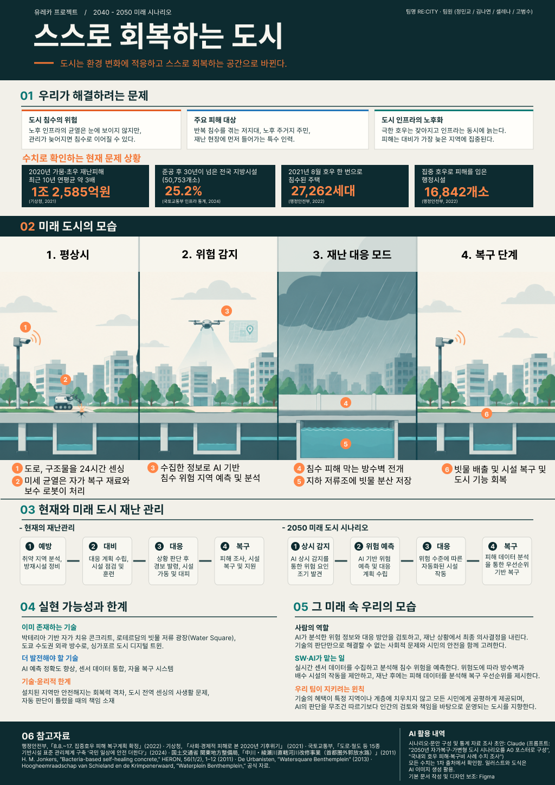

# Welcome to E26-SW01-05 - 코드웨이브

## 🎯 팀 슬로건

> "error는 있어도 포기는 없다."

## 🖼️ 팀 포스터

<div class="poster"></div>

<p align="center" class="poster-caption"><sub>포스터 제작 및 아이디어 제시: 김나연 / 아이디어 확장 및 발표: 정민교 / 아이디어 확장: 셀레나</sub></p>

[유레카 프로젝트 5팀.pdf](https://github.com/user-attachments/files/34455296/5.pdf)

1965년에 35년 뒤의 생활을 상상해 그린 이 그림처럼, 우리 팀이 그리는 미래를 포스터로 만들어 봅시다.
팀 활동으로 만든 포스터를 `poster.jpg` 파일 이름으로 이 repository에 업로드하면 위 그림이 팀 포스터로 바뀝니다.
파일 이름이 다르거나 png 파일이면 위 파일 이름을 맞추고, 출처 문구도 팀에 맞게 고쳐 주세요.

> **포스터 파일 권장 규격**: A4 세로 비율(1 : 1.414), 1240×1754px 이상, JPG, 2MB 이하.
> 홈페이지에서는 어떤 크기·비율의 파일을 올려도 같은 크기의 세로 틀 안에 맞춰 표시되지만, 권장 규격을 지키면 여백 없이 가장 선명하게 보입니다.

***

## 1️⃣ 팀원 소개

| **이름** | **전공** | **관심사** | **취미** |
| --- | --- | --- | --- |
| **고범수** | 소프트웨어학부 | 인공지능, 미디어 매체 | 스포츠시청 |
| **김나연** | 소프트웨어학부 | 웹 개발, 프로그래밍 | 자수 뜨개질 |
| **정민교** | 소프트웨어학부 | ai개발, 추천시스템 | 요리 |
| **셀레나** | 소프트웨어학부 | 코딩, 새로운 것 배우기 | 영화나 드라마 등 미디어 감상 |


### 팀 소개

실패를 두려워하지 않고, 오류가 생기면 함께 해결하며 끝까지 도전하는 팀입니다.
에러는 우리의 과정일 뿐, 포기하지 않는 것이 우리의 원칙입니다!

***

## 2️⃣ 공통된 관심사 : 여행, 백엔드, 인공지능

***

## 3️⃣ 한학기 동안의 활동 내역

####  <과거의 사람들이 꿈꾼 세상> 

## 📌 주제: 이정문 화백의 1965년 미래 상상도

---

## Team Mission 1: 과거 사례 4분류 및 근거

| 분류 | 사례 | 분류 근거 |
|---|---|---|
|  현재 가능 | 태양광 주택 | 태양광 패널 기술은 일반 주택에서도 보편적으로 설치·상용화됨 |
|  현재 가능 | 전기차 | 배터리 기술 발전과 충전 인프라 확대로 이미 대중 시장에서 널리 판매됨 |
|  현재 가능 | 인강(온라인 수업) | 인터넷·영상 플랫폼 보급으로 원격 학습이 일상적인 교육 방식으로 정착함 |
|  현재 가능 | 무빙워크 | 공항·쇼핑몰 등에서 이미 표준 설비로 자리 잡아 특별한 기술이 아니게 됨 |
|  일부 가능 | 청소 로봇(로봇청소기) | 자동 청소는 가능하지만 사람 수준의 완전 자율 가사도우미는 아니고 보조 도구 수준에 머묾 |
|  일부 가능 | 비대면 진료 | 기술적으로는 구현됐지만 법·제도적 규제로 아직 완전히 대중화되지 못함 |
|  일부 가능 | 자동 음식 배급기 | 밀키트·배달앱·조리로봇 등으로 기능이 분산 구현됐지만, 상상했던 하나의 통합 기계로는 실현되지 않음 |
|  아직 어려움 | 달나라 여행 | 기술적으로는 가능하나 비용·안전성 문제로 일반 대중에게 열려있지 않음 |
|  방향 전환 | 소형 TV 전화기 → 스마트폰 | 상상한 전용기기 형태 대신 통신·영상·컴퓨팅이 통합된 전혀 다른 형태의 기기로 실현됨 |
|  방향 전환 | 전파 신문 → 인터넷 뉴스 | 무선으로 인쇄물을 받는다는 원래 개념은 사라졌지만, 실시간 무선 정보 수신이라는 본질은 인터넷 뉴스로 계승됨 |

---

## Team Mission 2: Why-What-How-Next 심층 분석

### 선택 사례: 자동 음식 배급기

| 항목 | 내용 |
|---|---|
|  WHY (과거의 문제의식) | 산업화·도시화로 바빠진 일상 속에서 가사노동, 특히 매끼 식사 준비 부담을 줄이려는 욕구가 근본 동기였음 |
|  WHAT (상상한 해결 방식) | 버튼 하나로 완성 요리가 나오는 만능 자동 조리·배급 기계. 요리 과정 자체가 사라진 미래를 상상함 |
|  HOW (현재의 구현 방식) | 밀키트/HMR, 배달앱, 자판기형 조리로봇, 3D 푸드프린터 등으로 기능이 분산되어 부분적으로 구현됨 |
|  NEXT (남은 문제와 한계) | 통합된 만능 기계는 아직 없음. 배달노동자 처우, 일회용품 쓰레기 등 새로운 사회문제 발생 |

###  팀 핵심 질문
> 기술이 하나의 완제품이 아니라 여러 서비스로 흩어져 실현되는 게 일반적인 패턴일까?


***

####  <AI가 만들어 가는 세상> 

## 📌 주제: 대학생활 속 불편을 AI와 함께 다시 정의하기

---

## Team Mission 1: AI와 함께 문제 다시 쓰기

| 단계 | 내용 |
|---|---|
|  Before (관찰된 불편) | 북악관 엘리베이터는 멈추는 층이 고정되어 있어서 고장이 나면 불편하다. |
|  AI Questioning (사용한 프롬프트) | "이 상황의 핵심 문제와 사용자 요구사항을 추상화해서 다시 정의해줘. 사용자, 상황, 문제, 기대효과가 드러나게 써줘." |
|  After (개선된 문제 정의문) | 북악관에서 수업을 듣는 학생과 교직원은(사용자), 호기별로 정차 층이 고정된 엘리베이터 중 하나가 고장 났을 때(상황), 어느 호기를 타야 하는지 미리 알 수 없어 수업 직전에 우회하거나 계단을 이용하게 된다(문제). 고장 여부와 대체 경로를 미리 알 수 있으면 이동 시간 낭비와 지각을 줄일 수 있다(기대효과). |

###  검토 메모
> AI가 쓴 문장에는 "실시간 안내"라는 해결책이 문제 정의에 미리 들어가 있었음. 핵심 문제는 "대체 수단이 없는 구조에서 장애 정보가 사용자에게 전달되지 않는다"로 정리함.

---

## Team Mission 2: AI 아이디어 비교 및 선택

| 평가 기준 | 아이디어 A | 아이디어 B | 아이디어 C (선택) |
|---|---|---|---|
|  아이디어 | 고장 시 운행 규칙 변경 제안 | 시간표 연동 경로 안내 챗봇 | QR 제보 기반 고장 현황판 |
|  필요성 (Why) | 불편의 원인인 고정 정차 층 자체를 없앰 | 고장 여부뿐 아니라 어디로 가야 하는지까지 알려줌 | 고장 사실을 도착 전에 알 수 있어 헛걸음을 줄임 |
|  새로움 (Novelty) | 낮음. 기술이 아닌 운영 정책 제안임 | 높음. 개인 시간표와 건물 동선을 결합한 맞춤 안내임 | 중간. 제보 방식은 흔하지만 교내 엘리베이터에 적용한 사례는 없음 |
|  실현 가능성 (How) | 낮음. 결정권이 시설팀에 있고 설비 설정 변경이 필요함 | 낮음. 시간표 연동과 동선 데이터가 필요하고 고장 데이터가 먼저 있어야 함 | 높음. QR, 설문 폼, 간단한 웹 페이지만으로 만들 수 있음 |
|  위험 요소 (Risk) | 학교가 받아들이지 않으면 결과물이 남지 않음 | 잘못된 경로를 안내하면 오히려 지각을 유발하고 개인정보를 다뤄야 함 | 제보가 적거나 허위 제보가 들어오면 현황판을 믿을 수 없음 |

###  최종 선택 아이디어 및 선정 이유
> **아이디어 C: QR 제보 기반 고장 현황판**
>
> AI는 새로움이 가장 높은 B를 추천했지만, B는 고장 데이터가 있어야 동작하므로 C가 먼저 만들어져야 한다고 판단함. A는 원인을 직접 해결하지만 우리 팀이 결정할 수 없는 영역이라 제외함. C는 학교의 협조 없이 우리 팀이 직접 만들고 북악관에서 바로 검증할 수 있음.


[유레카 프로젝트 5팀.pdf](https://github.com/user-attachments/files/34455296/5.pdf)


- 기관/부서 인터뷰 ✔️  

- 현장 탐방 ✔️  

- 멘토링 ✔️  
  - 내 지도 교수 함게 만나기
  - 대학원 방문 및 선배 만나기

- 프로젝트 진행 ✔️  
  - 과거에 사람들이 상상한 미래
  - 그들이 만들어가는 세상
  - 우리가 상상한 미래
  - 우리가 그리는 미래 그리고 나

- 각오와 소감 나누기 ✔️  


<!-- 활동 사진 추가 예시 -->


***

## 4️⃣ 인상 깊은 활동

- 활동명 – 활동에 대한 간단한 설명과 배운 점을 작성  
- 예: 멘토링에서 실리콘밸리 현업 경험을 들을 수 있어 진로 방향 설정에 큰 도움이 되었다.  

***

## 5️⃣ 특별히 알아보고 싶은 것
- 예: 현장실습 제도
- 예: 학부 졸업 인증 조건
- 예: 성취기반평가
- 예: 졸업 후 진로(대학원/취업)

***

## 6️⃣ 활동을 마친 소감

🔗고범수  
> "소감 내용을 여기에 작성합니다."

🔗김나연  
> "소감 내용을 여기에 작성합니다."

🔗정민교  
> "소감 내용을 여기에 작성합니다."

🔗셀레나 
> "소감 내용을 여기에 작성합니다."


## Markdown을 사용하여 내용꾸미기를 익히세요.

Markdown은 작문을 스타일링하기위한 가볍고 사용하기 쉬운 구문입니다. 여기에는 다음을위한 규칙이 포함됩니다.

```markdown
Syntax highlighted code block

# Header 1
## Header 2
### Header 3

- Bulleted
- List

1. Numbered
2. List

**Bold** and _Italic_ and `Code` text

[Link](url) and 
```

자세한 내용은 [GitHub Flavored Markdown](https://guides.github.com/features/mastering-markdown/).

### Support or Contact

readme 파일 생성에 추가적인 도움이 필요하면 [도움말](https://help.github.com/articles/about-readmes/) 이나 [contact support](https://github.com/contact) 을 이용하세요.

